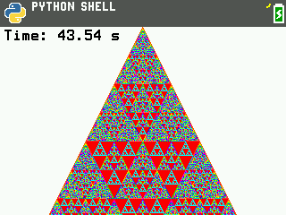

# Pascal's triangle on the TI-84 Evo

Python programs for the TI-84 Evo that draw Pascal's triangle mod 16: 210 rows, one pixel per entry, each remainder in its own hue. The repo also holds the benchmarks and probes used to find the fastest way to draw it, and what they revealed about the Evo's Python.



## Results

All times were measured on a TI-84 Evo running OS 7.0.0.3996. Every version draws the same 22,155 pixels.

| Program | Approach | Drawing calls | Time |
|---|---|---|---|
| `PASBENCH` (row test) | Row by row, one box per run of equal entries | 14,992 boxes, about 14,800 color changes | 163.1 s |
| `PASBENCH` (color test) | The same boxes, drawn one color at a time | 14,992 boxes, 17 color changes | 93.4 s |
| `PASFAST` | One background box per row, then the other colors | 11,713 boxes, 28 color changes | 73.4 s |
| `PASFAST2` | Layered boxes: long ones first, shorter ones on top | 9,111 boxes, 125 color changes | 58.6 s |
| `PASFAST3` | The same layers through the native `ti_graphics` calls | 9,111 boxes, 125 color changes | 50.6 s |
| `PASFAST4` | The bottom layer as two polygons instead of 210 boxes | 8,901 boxes plus any repairs, 2 polygons, 125 color changes | 48.8 s |
| `PASFAST5` | The sides of the zero triangles as lines, drawn last | 6,627 boxes plus any repairs, 744 lines, 2 polygons, 133 color changes | 43.5 s |

The row math is not the bottleneck: computing all 210 rows takes 0.04 s. Nearly all the time is the number of drawing calls, at 4 to 6 ms each.

## Programs

The name on the calculator is the file name without `.py`, cut to 8 characters.

| File | What it does |
|---|---|
| `programs/PASCAL.py` | The original: one `plot_xy` and one `set_color` per entry. Simple and slow. |
| `programs/PASFAST.py` | Row backgrounds. Documented calls only. |
| `programs/PASFAST2.py` | Layered boxes. Documented calls only. |
| `programs/PASFAST3.py` | Layered boxes through undocumented native calls. |
| `programs/PASFAST4.py` | `PASFAST3` with the bottom layer drawn as two polygons. |
| `programs/PASFAST5.py` | `PASFAST4` with the sides of the zero triangles drawn as lines. The fastest. |
| `benchmarks/PASBENCH.py` | Draws the triangle row by row and then color by color, and times each. |
| `benchmarks/CALLBENCH.py` | Times `set_color`, `fill_rect`, `plot_xy` and `ti_image.set_pixel` per call. On the calculator as `CALLBENC`. |
| `benchmarks/POLYBNCH.py` | Times `draw_line`, `draw_poly`, `fill_poly` and `ti_plotlib.scatter`, and draws test shapes. |
| `probes/MODDUMP.py` | Lists undocumented names in the TI modules, other importable modules, and interpreter facts. |
| `probes/GRPROBE.py` | Finds argument counts, speed and exact pixel behavior of the native `ti_graphics` calls. |
| `probes/GRPROBE2.py` | Tests `drawPolyLine`, `fillPolygon`, `drawString` and `pushImage`/`popImage`. |
| `probes/IMGPROBE.py` | Tests whether `ti_image.new_image` can make an off-screen image. It cannot. |
| `probes/TRIPROBE.py` | Finds which corner points make `fillPolygon` paint a triangle's rows exactly. |
| `probes/POLYRULE.py` | Measures what `fillPolygon` costs per corner, how it treats shapes that are not convex, and which rows of a shape it paints. |

The probes' reports are too long for the screen, so each draws its report as a block of black pixels that `tools/decode_bits.py` reads back from a screenshot. The decoded reports are in `docs/device-reports/`.

## How the fast version works

1. **Rows as big integers.** A whole row lives in one integer, one byte per entry. The next row is `(R + (R << 8)) & mask`, three native operations, so no Python loop touches individual entries.
2. **Layered boxes.** For each row, the first color gets one box from its first entry to its last. Whatever lies between its entries is planned the same way one layer deeper and painted over that box later. This needs 9,111 boxes where one box per run needs 14,992. The best possible layering needs 7,601, but finding it takes about 4 million steps on the calculator, more than it saves.
3. **One color at a time.** A color change costs about 4 ms, so boxes are grouped by layer and color and each group is drawn in one go, lower layers first.
4. **Native calls.** `ti_draw` is a Python wrapper around the native `ti_graphics` module. Calling `ti_graphics.fillRect` directly saves about 0.8 ms per box.
5. **Polygons for the bottom layer.** Every row starts and ends with 1, so the bottom layer is one full-width box per row in the same color: a solid triangle. `PASFAST4` paints it with two `fillPolygon` calls, then reads both ends of every row back with `getPixel` and repairs any pixel the polygons got wrong. The calculator's result matched the exact picture on every pixel.
6. **Lines for the sides of the zero triangles.** Every block of zeros in the picture is an upside-down triangle: two zeros side by side put a zero below them, so a run of zeros comes back one entry shorter on each row. The entries along its two slanted sides all have one value, because each is the entry above it plus a zero. On screen such a side is a straight line, so `PASFAST5` paints each with one `drawLine` call, after the boxes. The boxes no longer have to get those entries right, so the boxes on either side of them join up: 6,627 boxes and 744 lines do the work of 8,901 boxes. Only triangles 3 or more entries wide are used; the sides of a single zero are too short to pay for a line.

`drawLine` is undocumented, so `PASFAST5` first draws one line of each shape it plans to use (8 of them here) and reads it back. If a shape came out wrong it would plan again without that shape and show the number of shapes dropped under the time. On the calculator all 8 passed.

## What the probes found about the Evo's Python

These are measurements from one calculator on OS 7.0.0.3996. The undocumented functions may change or disappear in other OS versions.

**Cost per call**

| Call | Time |
|---|---|
| `ti_graphics.getPixel` | 0.05 ms |
| `ti_graphics.setColor` | 3.9 ms |
| `ti_draw.set_color` | 4.1 ms |
| `ti_graphics.fillRect` | 5.5 to 5.7 ms |
| `ti_draw.fill_rect` | 6.0 to 6.5 ms |
| `ti_graphics.setPixel` | 6.2 ms |
| `ti_graphics.drawLine` | 6.5 ms |
| `ti_image.set_pixel` | 7.4 ms |
| `ti_draw.draw_line` | 8.3 ms |
| `ti_graphics.fillPolygon` | about 9 ms for 3 corners and about 2.2 ms for each corner after that (107 ms for 48); the size of the shape does not matter |
| `ti_draw.plot_xy` | 12.5 ms |
| `ti_graphics.drawPolyLine` | 6.2 ms for 2 points, about 2 ms per extra point, 50 points at most |
| `ti_graphics.drawString` | 4.5 ms for 1 character, about 0.13 ms per extra character |
| `ti_graphics.pushImage` + `popImage` | 7.7 ms for 6×4 pixels, 8.4 ms for 100×60 |
| `ti_plotlib.scatter` | about 7.4 ms per point |

Reading the screen is cheap; every call that changes the screen or the drawing state costs 4 to 6 ms inside the calculator's own code, and no bulk call gets around it.

**`ti_draw` behavior**

- The drawing area is 320×210 pixels. Drawing outside it is silently ignored.
- `fill_rect(x, y, w, h)` fills only the inside of the box, and a width or height below 2 raises `tidrawException`. To fill exactly `w` by `h` pixels at `(x, y)`, call `fill_rect(x - 1, y - 1, w + 1, h + 1)`.
- `draw_text(x, y, s)` puts glyphs in rows `y - 17` to `y - 3`, 10 pixels per character.
- `plot_xy(x, y, 7)` is a single pixel.
- `print()` wipes the drawing. Print before drawing the final screen, not after.
- `show_draw()` holds the screen until CLEAR is pressed.
- `use_buffer` exists but raises "Unsupported operation."

**The native layer**

- `ti_draw.mpy` and `ti_image.mpy` are compiled Python; `ti_graphics` is native and has 18 undocumented names, including `fillRect`, `setPixel`, `setColor`, `drawLine`, `drawPolyLine`, `fillPolygon`, `drawString`, `getPixel`, `cls`, `pushImage` and `popImage`.
- Native coordinates are full-screen: the drawing area starts at y = 30.
- `fillRect(x, y, w, h)` fills exactly `w` by `h` pixels, and 1×1 works. `drawLine` includes both end points. `drawRect(x, y, w, h)` outlines `w + 1` by `h + 1` pixels.
- `setColor` takes one `(r, g, b)` tuple. `setPixel(x, y, (r, g, b))` takes the color as its third argument. `drawPolyLine` and `fillPolygon` take one list of `(x, y)` tuples.
- For the lines `PASFAST5` uses, which move one pixel sideways every two rows and are 2, 4, 8 or 16 rows long, `drawLine` paints exactly one pixel on each row, where the picture's entries are. Other slopes and lengths were not tested.
- `popImage()` restores a region saved by `pushImage(x, y, w, h)` in the same place. It cannot copy a region elsewhere.
- `fillPolygon` leaves out the bottom row of the shape, and its slanted edges do not follow the triangle's staircase exactly. For the full triangle (top at screen (159, 30), bottom row x 55 to 264 at y 239), corners `(159, 30), (54, 240), (264, 240)` get every right end exactly but miss the leftmost pixel on 41 rows; corners `(159, 30), (54, 239), (264, 239)` get the left edge exactly on every row but the last and spill one pixel past the right edge on 41 rows. An upside-down 15-row triangle drawn with its exact corners is right on every row except its one-pixel tip. `docs/device-reports/TRIPROBE.txt` has all 32 corner choices tried.
- `fillPolygon` takes at most 50 corners. It fills shapes that are not convex correctly, and where a path overlaps itself the overlap is left empty. A path that goes out and comes back along the same line paints that line one pixel wide. Corners with fractions are accepted and the fractions dropped.
- Because of the cost per corner, one polygon for several boxes does not pay: a box needs 4 corners, about 9 ms, against 5.7 ms for `fillRect`.
- On each row, `fillPolygon` paints from the left edge to the right edge of the shape, both rounded to the nearest pixel. Walking each edge down from its top corner in steps of 1/256 pixel reproduces 932 of the 934 row ends measured in the first 128 rows of the test shapes. From the 128th row down, the whole-picture triangle has one end pixel wrong on every even row; the cause is not known.
- A zero triangle (an upside-down block of zeros, top row from x = L to R at row y, tip at x = m on row t) is painted exactly, tip included, by the 4 corners `(L, y), (R, y), (m, t), (m + 1, t + 1)`. All 358 complete ones in the picture were checked. `docs/device-reports/POLYRULE.txt` has the full report.
- `ti_image.new_image` and `ti_image.copy_image` raise "Unsupported operation."

**The interpreter**

- It reports itself as `tipython` 1.13 with Python 3.4.0 syntax. About 163 KB of memory is available to a program.
- Importable beyond the TI modules: `sys`, `gc`, `array`, `math`, `random`, `time`, `collections`, `builtins`. There is no `os`, `struct` or `framebuf`. `open` exists, but it returned `None` for the one file tried (`ti_plotlib.py`).
- `time` has `monotonic`, `sleep`, `ticks_ms` and `ticks_diff`.
- `x in some_bytearray` raises `NotImplementedError`; use a list.

## Putting programs on the calculator

The programs were sent over USB with [evo_usb_py](https://github.com/jakebromberg/evo_usb_py), a fork with the OS-update command removed:

```sh
EVO_USB_SERIAL=/dev/cu.usbmodemRTX_DUMMY1 python3 evo_usb.py programs/PASFAST5.py PASFAST5
EVO_USB_SERIAL=/dev/cu.usbmodemRTX_DUMMY1 python3 evo_usb.py --screenshot shot.png
```

- Names are at most 8 letters and digits.
- Programs go to RAM, and the Python app only lists programs in RAM. A RAM clear removes them all, so keep copies.
- **While a program is on screen, send nothing but screenshots.** The calculator's RAM was cleared twice during this work. The second time came right after a file listing was requested while a program's final screen was showing; that request also tells the calculator to go to its home screen. This is the likely cause, not a confirmed one. `tools/screen_kind.py` tells a running program's screen from a menu.

## Checking programs on a computer

`tools/check.sh` runs every program under MicroPython with stand-in TI modules. It needs `python3` and the `micropython` command (on macOS: `brew install micropython`).

```sh
sh tools/check.sh
```

- The six triangle programs must draw the exact picture: every pixel right, nothing outside the triangle, and no text over it.
- Benchmarks and probes only have to finish without an error.
- The tools' own tests run last, against a real screenshot and a saved device report.

The stand-ins in `tools/standins/` follow the behavior listed above. They do not model memory limits, timing (the clock never advances), or anything the probes did not measure, so a pass here is necessary but not sufficient. In particular the stand-in `fillPolygon` uses an ordinary scanline fill, not the calculator's edge rule, so `PASFAST4` passes there only because its read-back repair works.

| Tool | Use |
|---|---|
| `tools/validate.py [--run-only] <program.py>` | Run one program and compare its drawing with the exact triangle. |
| `tools/check_screenshot.py <shot.png>` | Check a real screenshot against the exact triangle, including stray pixels outside it. |
| `tools/decode_bits.py <shot.png>` | Decode a probe's pixel-block report. |
| `tools/screen_kind.py <shot.png>` | Print `drawing`, `python-menu` or `other`. |

## Other files

- `docs/device-reports/` holds the decoded probe reports, plus the `GRPROBE2` screenshot the tests decode.
- `backup/PISUMSEQ.bin` is an unrelated TI-BASIC program saved from the calculator with `evo_usb.py --get-file PISUMSEQ 2` before a RAM clear. It is the raw variable as the tool returned it; sending it back is untested.
